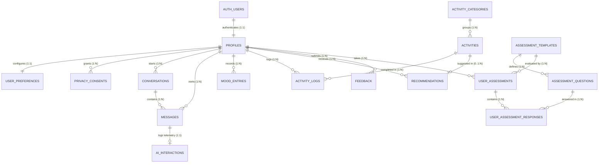

# MindMitra – Database Architecture & Schema Documentation

> **Application:** MindMitra – AI Companion for Emotional Well-being  
> **Database Engine:** PostgreSQL 15+ (Supabase)  
> **Auth System:** Supabase Auth (`auth.users`)  
> **Security Model:** Row Level Security (RLS) + Server-Side AES-256-GCM Encryption + PII Sanitization  

---

## 1. System Architecture & Privacy Data Flow

```
┌─────────────────────────────────────────────────────────────┐
│                   React + TypeScript Client                 │
│  - Presentation & State Only                                │
│  - Supabase Auth (Client Token)                             │
│  - ZERO encryption keys, ZERO Gemini API keys               │
└──────────────┬──────────────────────────────▲───────────────┘
               │ 1. User Message / Action     │ 7. Sanitized/
               │ (Standard HTTPS/JWT)         │    Decrypted Data
               ▼                              │
┌─────────────────────────────────────────────┴───────────────┐
│               Node.js + Express API Gateway                 │
│  - Supabase Service Role (Privileged Operations)            │
│  - AES-256-GCM Server-Side Encryption/Decryption Engine     │
│  - PII Detection & Sanitizer Pipeline (Regex + NER)         │
│  - Key Management Service (KMS / Server Env Vars)           │
└──────────────┬──────────────────────────────▲───────────────┘
               │ 2. Scrubbed /                │ 5. Empathetic
               │    Sanitized Prompt          │    Response
               ▼                              │
┌──────────────────────────────────────────────┐┌──────────────┴───────────────┐
│ Client / WebAssembly Transformers.js Engine  ││       Google Gemini API       │
│ - DistilRoBERTa (`j-hartmann` / ONNX runtime)││ - Foundation LLM Reasoning   │
│ - Zero-Latency Emotion Probabilities (7-cls) ││ - Strict Zero-PII Context     │
└──────────────┬───────────────────────────────┘└──────────────────────────────┘
               │ 3. Emotion Vectors & Source Attribution ('emotion_classifier' | 'gemini_companion')
               ▼
┌─────────────────────────────────────────────────────────────┐
│                 Supabase PostgreSQL Database                │
│  - Strict Row Level Security (RLS) on all user tables       │
│  - Stored Ciphertext (encrypted_content, iv, auth_tag)      │
│  - Audit Logs & AI Interaction Telemetry                    │
└─────────────────────────────────────────────────────────────┘
```

---

## 2. Entity Relationship Diagram (ERD)



---

## 3. Database Migration Inventory

All schema components are separated into ordered, isolated migration scripts located in `supabase/migrations/`:

| Migration File | Primary Responsibility | Target Tables / Types |
| :--- | :--- | :--- |
| `001_extensions.sql` | PostgreSQL extensions setup | `uuid-ossp`, `pgcrypto`, `citext` |
| `002_profiles.sql` | 1:1 Identity table for users | `public.profiles` |
| `003_user_preferences.sql` | Personal preferences & regional languages | `public.user_preferences` |
| `004_activity_categories.sql` | Wellness exercise taxonomies | `public.activity_categories` |
| `005_activities.sql` | Curated exercises, meditations & breathwork | `public.activities` |
| `006_conversations.sql` | AI Companion conversation threads | `public.conversations` |
| `007_messages.sql` | Encrypted chat history & emotion tagging | `public.messages` |
| `008_mood_entries.sql` | Daily mood scores, triggers & notes | `public.mood_entries` |
| `009_wellness_assessments.sql` | Standardized surveys (WHO-5, daily pulse) | `assessment_templates`, `assessment_questions`, `user_assessments`, `user_assessment_responses` |
| `010_activity_logs.sql` | Completion telemetry, duration & ratings | `public.activity_logs` |
| `011_recommendations.sql` | Dynamic rule/AI suggested interventions | `public.recommendations` |
| `012_feedback.sql` | Centralized rating & feedback repository | `public.feedback` |
| `013_ai_interactions.sql` | AI latency, token telemetry & PII logs | `public.ai_interactions` |
| `014_privacy_consent.sql` | GDPR/DPDP consent audit trails | `public.privacy_consents` |
| `015_indexes.sql` | Query performance & foreign key indexes | All indexed tables |
| `016_triggers.sql` | `updated_at` timestamps & user onboarding | `handle_updated_at()`, `handle_new_auth_user()` |
| `017_rls.sql` | Row Level Security policies | Strict `auth.uid()` checks on all user data |
| `018_seed_data.sql` | Seed activities, categories & surveys | Initial curated mental health tools |
| `019_storage.sql` | Supabase Storage bucket & isolation | `avatars` bucket |

---

## 4. Table Catalog & Column Breakdown

### 4.1. `public.profiles`
- **Purpose:** Houses public user identity linked directly with Supabase Auth (`auth.users`).
- **User-Owned:** Yes (`id = auth.uid()`).
- **Columns:**
  - `id (UUID, PK)`: Matches `auth.users.id` with `ON DELETE CASCADE`.
  - `email (CITEXT, UNIQUE)`: Validated email address.
  - `display_name (TEXT)`: Preferred user moniker (1–100 characters).
  - `avatar_url (TEXT)`: Storage reference to profile photo.
  - `timezone (TEXT)`: Default `'UTC'`.
  - `date_of_birth (DATE)`: Optional for age-relevant wellness personalization.
  - `created_at / updated_at (TIMESTAMPTZ)`: Maintained by trigger.
  - `deleted_at (TIMESTAMPTZ)`: Soft-deletion timestamp for deactivation.

### 4.2. `public.user_preferences`
- **Purpose:** Stores user settings, reminder preferences, and regional language selection.
- **User-Owned:** Yes (`user_id = auth.uid()`).
- **Columns:**
  - `preferred_language`: `en`, `hi`, `ta`, `te`, `kn`, `ml`, `mr`, `bn`, `gu`, `pa`.
  - `communication_style`: `empathetic`, `direct`, `gentle`, `reflective`, `humorous`.
  - `daily_reminder_enabled / daily_reminder_time`: Automated notification scheduling.
  - `ai_voice_enabled`: Audio synthesis preference.
  - `preferred_activity_types`: Array of preferred intervention types (`TEXT[]`).
  - `theme`: UI visual theme (`light`, `dark`, `system`).

### 4.3. `public.conversations` & `public.messages`
- **Purpose:** Thread management and conversational memory between user and MindMitra.
- **User-Owned:** Yes (`user_id = auth.uid()`).
- **Encryption & Privacy Columns (`public.messages`):**
  - `role`: `user`, `assistant`, `system`.
  - `source`: Source attribution (`'emotion_classifier'` vs `'gemini_companion'`).
  - `content`: Plaintext display content (when permitted).
  - `encrypted_content`: Server-side AES-256-GCM encrypted ciphertext.
  - `encryption_iv`: Initialization vector / nonce (unique per row).
  - `encryption_tag`: 128-bit authentication tag validating payload integrity.
  - `is_encrypted`: Boolean indicating whether record requires backend decryption.
  - `is_sanitized`: Audit flag verifying PII scrubbing before external LLM calls.
  - `sanitized_content`: The scrubbed prompt version submitted to Gemini.
  - `detected_emotion`: Dominant emotion tag from DistilRoBERTa Transformers.js inference.
  - `emotion_confidence`: Numerical score (0.00–100.00%).

### 4.4. `public.mood_entries`
- **Purpose:** Daily emotional state recording for longitudinal tracking and chart visualization.
- **User-Owned:** Yes (`user_id = auth.uid()`).
- **Columns:**
  - `mood_score (INT)`: Enforced range `1` to `10`.
  - `mood_label (VARCHAR)`: e.g. "Peaceful", "Stressed", "Exhausted".
  - `primary_emotion (VARCHAR)`: Classified root emotion.
  - `secondary_emotions (TEXT[])`: Complementary feelings.
  - `encrypted_notes (TEXT)`: Journal notes protected with AES-256-GCM.
  - `triggers (TEXT[])`: Associated contexts (work, sleep, relationships, etc.).
  - `recorded_at (TIMESTAMPTZ)`: Point-in-time timestamp.

### 4.5. `public.assessment_templates`, `questions`, `user_assessments`, `responses`
- **Purpose:** Structured, normalized psychiatric and wellness questionnaires (e.g. WHO-5).
- **Structure:**
  - `assessment_templates`: Master questionnaire definitions and scoring ranges.
  - `assessment_questions`: Ordered questions with structured scoring options (`JSONB`).
  - `user_assessments`: Header of assessment taken by user with overall score and category.
  - `user_assessment_responses`: Normalized individual question selections.

### 4.6. `public.activities` & `public.activity_logs`
- **Purpose:** Curated catalog of evidence-based interventions and tracking of completions.
- **Activity Log Columns:**
  - `status`: `started`, `in_progress`, `completed`, `abandoned`.
  - `duration_seconds`: Actual elapsed time.
  - `user_rating`: User feedback rating (1–5).
  - `user_reflection`: Post-activity thought.

### 4.7. `public.recommendations`
- **Purpose:** Proactive suggestions triggered by mood score drops, high stress, or habits.
- **Columns:**
  - `recommendation_type`: `activity`, `breathing_exercise`, `crisis_resource`, etc.
  - `context_source`: `mood_trigger`, `assessment_result`, `chat_emotion`, `routine`.
  - `is_viewed`, `is_accepted`, `is_dismissed`: User engagement tracking.

### 4.8. `public.ai_interactions`
- **Purpose:** Internal operational telemetry for Gemini / DistilBERT interactions.
- **Safety Guarantee:** NO API keys stored, NO raw prompts duplicated.
- **Columns:** `latency_ms`, `prompt_tokens`, `completion_tokens`, `total_tokens`, `pii_detected`, `pii_entities_sanitized`, `status`.

### 4.9. `public.privacy_consents`
- **Purpose:** Unalterable audit trail of user agreements to terms, AI processing, and policies.
- **Columns:** `consent_type`, `consent_version`, `is_granted`, `ip_address_hash` (pseudonymized SHA-256), `granted_at`, `revoked_at`.

---

## 5. Security & Row Level Security (RLS) Matrix

| Table Name | SELECT Policy | INSERT Policy | UPDATE Policy | DELETE Policy |
| :--- | :--- | :--- | :--- | :--- |
| `profiles` | `auth.uid() = id` | `auth.uid() = id` | `auth.uid() = id` | `auth.uid() = id` |
| `user_preferences` | `auth.uid() = user_id` | `auth.uid() = user_id` | `auth.uid() = user_id` | `auth.uid() = user_id` |
| `activity_categories` | `is_active = true` (Public) | Service Role Only | Service Role Only | Service Role Only |
| `activities` | `is_active = true` (Public) | Service Role Only | Service Role Only | Service Role Only |
| `conversations` | `auth.uid() = user_id` | `auth.uid() = user_id` | `auth.uid() = user_id` | `auth.uid() = user_id` |
| `messages` | `auth.uid() = user_id` | `auth.uid() = user_id` | `auth.uid() = user_id` | `auth.uid() = user_id` |
| `mood_entries` | `auth.uid() = user_id` | `auth.uid() = user_id` | `auth.uid() = user_id` | `auth.uid() = user_id` |
| `assessment_templates`| `is_active = true` (Public) | Service Role Only | Service Role Only | Service Role Only |
| `assessment_questions`| Active Template (Public) | Service Role Only | Service Role Only | Service Role Only |
| `user_assessments` | `auth.uid() = user_id` | `auth.uid() = user_id` | `auth.uid() = user_id` | `auth.uid() = user_id` |
| `user_assessment_responses`| Own Assessment Instance | Own Assessment Instance | Own Assessment Instance | Own Assessment Instance |
| `activity_logs` | `auth.uid() = user_id` | `auth.uid() = user_id` | `auth.uid() = user_id` | `auth.uid() = user_id` |
| `recommendations` | `auth.uid() = user_id` | `auth.uid() = user_id` | `auth.uid() = user_id` | `auth.uid() = user_id` |
| `feedback` | `auth.uid() = user_id` | `auth.uid() = user_id` | `auth.uid() = user_id` | `auth.uid() = user_id` |
| `ai_interactions` | `auth.uid() = user_id` | Service Role Only | Service Role Only | Service Role Only |
| `privacy_consents` | `auth.uid() = user_id` | `auth.uid() = user_id` | `auth.uid() = user_id` | **Disabled (Audit Trail)** |

---

## 6. Cryptography & Sensitive Data Handling

### 6.1. AES-256-GCM Implementation Rules
1. **Key Storage:** The master encryption key (`MINDMITRA_ENCRYPTION_KEY_256`) is stored strictly in server-side environment variables or KMS. It **never** enters the database, Git repositories, or frontend bundles.
2. **IV/Nonce:** A cryptographically secure random 12-byte (96-bit) IV is generated for **every single encryption operation** (`crypto.randomBytes(12)`). IVs are stored alongside the ciphertext in `encryption_iv`.
3. **Authentication Tag:** GCM produces a 16-byte (128-bit) authentication tag (`encryption_tag`). This prevents ciphertext tampering or bit-flipping attacks.

```typescript
// Backend Node.js Encryption Utility Reference
import crypto from 'crypto';

const ALGORITHM = 'aes-256-gcm';
const KEY = Buffer.from(process.env.MINDMITRA_ENCRYPTION_KEY_256!, 'hex');

export function encryptField(plainText: string): { ciphertext: string; iv: string; tag: string } {
  const iv = crypto.randomBytes(12);
  const cipher = crypto.createCipheriv(ALGORITHM, KEY, iv);
  let encrypted = cipher.update(plainText, 'utf8', 'hex');
  encrypted += cipher.final('hex');
  const tag = cipher.getAuthTag().toString('hex');
  return {
    ciphertext: encrypted,
    iv: iv.toString('hex'),
    tag
  };
}

export function decryptField(ciphertext: string, ivHex: string, tagHex: string): string {
  const decipher = crypto.createDecipheriv(ALGORITHM, KEY, Buffer.from(ivHex, 'hex'));
  decipher.setAuthTag(Buffer.from(tagHex, 'hex'));
  let decrypted = decipher.update(ciphertext, 'hex', 'utf8');
  decrypted += decipher.final('utf8');
  return decrypted;
}
```

### 6.2. PII Sanitization Flow
1. User transmits prompt to Express API Gateway over TLS 1.3.
2. Gateway routes text through PII Redaction module (Named Entity Recognition + Presidio/Regex).
3. Personal names, phone numbers, email addresses, and locations are replaced with pseudo-tokens (e.g. `[NAME_1]`, `[PHONE_1]`).
4. The redacted prompt is stored in `messages.sanitized_content` and transmitted to the Gemini API.
5. The raw message is encrypted via AES-256-GCM and stored in `messages.encrypted_content`.
6. Telemetry is written to `ai_interactions` recording `pii_detected = true` and `pii_entities_sanitized = ['NAME', 'PHONE']`.

---

## 7. Automated Triggers

1. **`on_auth_user_created`:** Trigger on `auth.users` after insert. Automatically creates corresponding row in `public.profiles`, initializes default `public.user_preferences` (English, empathetic tone), and records initial terms acceptance.
2. **`handle_updated_at`:** Attached to all mutable tables to ensure `updated_at` reliably mirrors modification time without client tampering.

---

## 8. Deletion & Data Retention Policy

- **Soft Delete:** Users can deactivate their account via `profiles.deleted_at = now()`. The profile and historical records remain protected under RLS and excluded from active queries.
- **Hard Delete (Right to be Forgotten):** When an account is permanently purged via `auth.users.delete()`, all cascaded user data across `profiles`, `conversations`, `messages`, `mood_entries`, `activity_logs`, and `recommendations` are automatically destroyed via PostgreSQL `ON DELETE CASCADE`.
